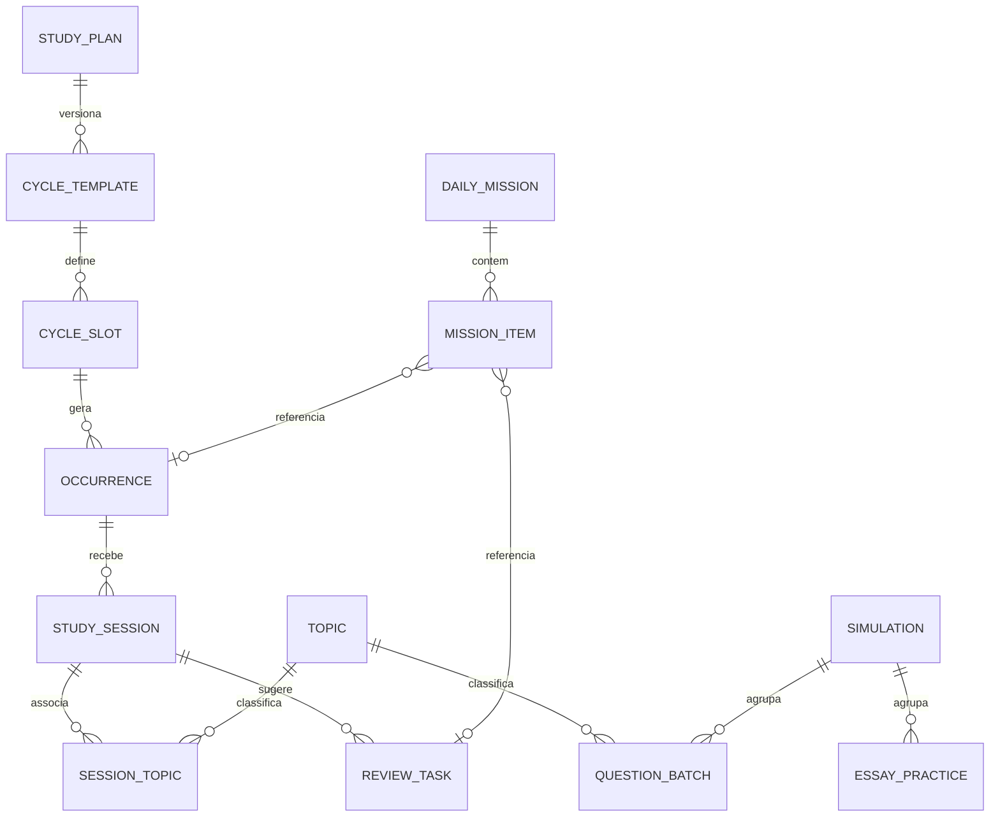

# Modelo de domínio

Versão 2.0 · 09/10/2026.

## Vocabulário

**Concurso** é o perfil; **versão do edital** contém regras e catálogo daquela referência. **Disciplina** é um dos 13 grupos. **Tópico** é um dos 68 itens macro sintetizados. **Bloco** (slot) é o modelo de uma sessão planejada; **ocorrência** é sua posição em determinada data. **Sessão** registra estudo realizado. **Lote** agrega tentativas de questões; não é banco de enunciados. **Simulado** reúne evidências de um conjunto completo. **Treino discursivo** guarda produção/avaliação pessoal. **Revisão** é uma ação futura sugerida.

Camada de jogo: **missão** é a lista congelada de itens de um dia; **folga** é um dia útil declarado neutro para a sequência; **etapa** é uma fase do plano com metas e um **chefão**. **XP, nível, sequência, congelamento e conquista** são valores derivados, sem tabela própria.

## Entidades

IDs de registros são UUID gerados pelo cliente na criação; códigos editoriais (B01, E01.02, S01, A01) são IDs estáveis de catálogo/configuração. Registros mutáveis têm `created_at`, `updated_at` e `version` inteiro iniciado em 1. Instantes: ISO-8601 UTC. Datas civis: YYYY-MM-DD. Não existe `user_id`: a instância pertence a um único dono.

| Entidade | Campos principais | Relações e restrições |
|---|---|---|
| Settings | id=1, timezone, weekly_goals, daily_question_goal, streak_min_minutes | Linha única; padrões em `gamificacao.json` |
| ExamVersion | id, exam_id, publication_date, source_url, source_sha256, exam_date, scoring_rules | Imutável; alteração cria nova versão |
| Subject | id, exam_version_id, code, title, paper, source_ref | P1/P2/P3; código único por versão |
| Topic | id, subject_id, code, title, source_ref, is_summary | Uma disciplina |
| TopicProgress | topic_id, status, declared_on, version | Único por tópico |
| StudyPlan | id, exam_version_id, starts_on, ends_on | Plano corrente; 09/10–11/12/2026 |
| CycleTemplate | id, study_plan_id, effective_from, weekly_minutes, origin | `origin`: `initial|rebalance|manual`; `effective_from` segunda-feira, único por plano |
| CycleSlot | id, cycle_template_id, code, weekday, window, minutes, purpose, activity, candidate_topic_ids, selection_mode | 15 por template |
| Occurrence | id, cycle_slot_id, week_start, planned_on, window, status, skip_reason? | Único por (slot, week_start); `planned_on`/`window` mudam no remanejamento. Data de conclusão derivada = maior `studied_on` das sessões ativas vinculadas |
| StudySession | id, occurrence_id?, studied_on, duration_minutes, activity, essay_kind?, notes, essay_practice_id?, deleted_at? | Uma ou várias por ocorrência; `essay_kind` obrigatório se activity=essay; `studied_on ≤ hoje` |
| SessionTopic | session_id, topic_id | Minutos contam uma vez por sessão |
| DailyMission | id, mission_date, kind, checkout_note?, created_at | Única por data; `kind`: `weekday|free` |
| MissionItem | id, mission_id, position, kind, ref_id?, target?, required, na_reason? | `kind`: `block|review|questions|checkout`; `na_reason` não nulo = `not_applicable` |
| DayOff | date, reason | Dia útil neutro para sequência; único por data |
| QuestionBatch | id, session_id?, topic_id, paper, practiced_on, total, correct, wrong, blank, double_marked, source_url?, source_label, answer_key_version?, simulation_id?, deleted_at? | Contagens válidas; nota derivada |
| ErrorNote | id, topic_id, batch_id?, noted_on, reason, explanation, reference?, reviewed_on?, resolved_on? | Causas: content, reading, confusion, guessing, time |
| ReviewTask | id, session_id, topic_id, offset_days, due_on, status, completed_on?, closed_by? | Único por sessão/tópico/intervalo; `closed_by` aponta a revisão cuja conclusão a fechou (sem XP) |
| FlashcardBatch | session_id, model, studied, origin, focus, priorities | Uma geração vigente por sessão (R16) |
| Flashcard | id, session_id, topic_id, subitem, category, front, back, status, last_rating?, rated_at? | `draft|approved`; só aprovados entram na revisão |
| EssayPractice | id, practiced_on, kind, duration_minutes, declared_lines, prompt_reference, text?, rubric, manual_score?, score_source?, simulation_id?, deleted_at? | Tipo fixa limites; sem upload |
| Simulation | id, exam_version_id, practiced_on, label, conditions | `conditions`: `standard|exam_day` (chefão etapa 3) |

Seeds/configuração somente leitura (de `docs/data/`): catálogo, ciclo inicial, etapas, tabela de XP, níveis, conquistas.

StudySession.activity: `theory|questions|review|essay`. Criar um treino pela tela de discursiva cria a sessão correspondente na mesma transação; relatórios somam minutos só de StudySession.

## Valores derivados (sem persistência)

| Valor | Entrada | Função pura |
|---|---|---|
| Estado de item de missão | Ocorrência, revisão, lotes do dia, checkout | `mission_item_state` |
| Missão completa | Itens | `mission_complete` |
| XP por data e total | Registros ativos + tabela XP | `xp_ledger` |
| Nível e título | XP total | `level_for_xp` |
| Sequência, recorde, congelamentos | Minutos por data, folgas, semanas completas | `streak_state` |
| Metas semanais | Ocorrências, sessões, lotes, discursivas, missões | `weekly_goals_progress` |
| Etapa, metas e chefão | Data, registros, simulados, progresso | `stage_progress` |
| Conquistas | Registros + estado de sequência | `achievements` |
| Sugestão de rebalanceamento | Simulado diagnóstico, template vigente | `suggest_rebalance` |

`xp_ledger` devolve entradas `{date, source, ref_id, xp}` para que o toast e o histórico expliquem cada ganho.

## Relacionamentos principais

## Invariantes

- Foreign keys válidas; `MissionItem.ref_id` aponta para ocorrência (kind=block) ou revisão (kind=review).
- Quantidades não negativas; `correct+wrong+blank+double_marked=total`, `total>0`.
- Duração 1–720; linhas declaradas ≥ 0, inteiras.
- `manual_score` entre 0 e limite do tipo; `score_source` obrigatório se houver nota.
- Um EssayPractice ligado a uma única sessão; edição de tempo atualiza ambos em transação.
- Sessão sem ocorrência aceita apenas tópicos da versão ativa do plano.
- Simulado usa uma única versão; soma exata 40/40/90 determina completude.
- Uma missão por data; itens imutáveis após geração, exceto `na_reason` e `checkout_note`.
- Um template por (`study_plan_id`, `effective_from`); ocorrências geradas nunca mudam de template.
- Sem cascata física que apague histórico ao atualizar catálogo.
- Mesmo `id` com conteúdo diferente em criação → 409; edição exige `version` atual.

QuestionBatch e EssayPractice vinculados a uma sessão excluída logicamente são marcados excluídos na mesma operação e ignorados em métricas e XP.

## Histórico

Versões de edital são preservadas. Mudança de tópico entre versões exige tabela de mapeamento explícita. Exportações incluem IDs originais e `schema_version`. A configuração de jogo (`gamificacao.json`) tem versão própria; mudar valores de XP recalcula todo o histórico, o que é aceitável porque XP é derivado e não oficial.
