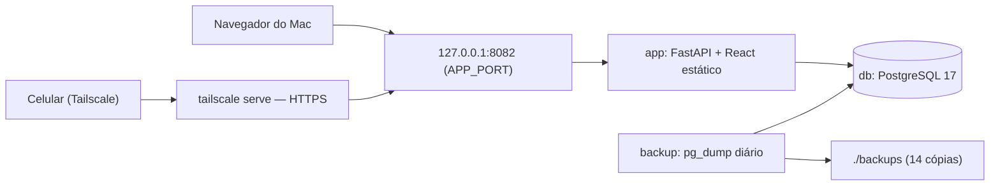
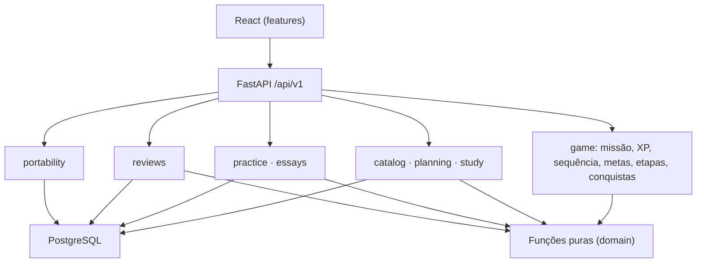

# Arquitetura e contratos

Versão 2.0 · 09/10/2026.

## 1. Decisão de arquitetura

Aplicação web pessoal e local: **frontend React/TypeScript** compilado e servido pela **API FastAPI/Python**, persistência em **PostgreSQL**, tudo orquestrado por **`docker compose`** no Mac do usuário. Um monólito modular; sem microsserviços, fila, Redis, banco vetorial ou agente. Sem login (usuário único, R10). React é ferramenta do produto e não substitui o estudo de Vue.js do edital.

Alternativas descartadas na v2.0: Supabase/BaaS (exigiria conta e dados fora da máquina), Spring Boot + Vue (alinhado ao edital, mas mais lento para a v1 do mesmo dia), imagem única com Postgres embutido (complica backup e atualização).

## 2. Execução



| Serviço | Imagem | Notas |
|---|---|---|
| `app` | Build multi-stage: Node compila `apps/web` → Python serve `apps/api` + `/static` | Porta `127.0.0.1:${APP_PORT:-8082}:8000`; roda `alembic upgrade head` e seed idempotente ao iniciar |
| `db` | `postgres:17.6` | Volume nomeado `pgdata` (`cgu2026_pgdata`); acesso interno em `db:5432`, sem porta publicada; healthcheck |
| `backup` | Mesma imagem do Postgres | Laço diário de `pg_dump -Fc` para `./backups`, mantém 14 arquivos |

- Coexistência local: o namespace Compose `cgu2026`, sua rede padrão `cgu2026_default`, o volume existente `cgu2026_pgdata`, os bancos e os backups são preservados. Cada projeto usa seu próprio PostgreSQL. `APP_PORT` no `.env` da raiz escolhe a porta externa do app; ausente ou vazia usa `8082`. A variável do terminal tem precedência, inclusive quando vazia.
- Acesso pelo celular: `tailscale serve --bg 8082` (ou a porta escolhida em `APP_PORT`) no Mac publica `https://<mac>.<tailnet>.ts.net` só dentro da tailnet, com certificado válido (necessário para instalar o PWA). Nunca usar `tailscale funnel`.
- Segredos (senha do Postgres) em `.env` fora do Git; `.env.example` versionado. `ALLOWED_HOSTS` lista `127.0.0.1`, `localhost` e o nome `*.ts.net` do Mac. `BACKUP_DIR` permite apontar os backups para uma pasta sincronizada (ex.: iCloud Drive) e ter cópia fora do disco.
- Pré-requisito ainda não instalado em 09/10/2026: **Tailscale** no Mac e no celular. Sem ele, a v1 funciona só no Mac.
- Banco de testes: database `cgu_test` criado no mesmo serviço `db` por script de init (`ops/db-init/`). O `Dockerfile` tem os alvos `dev` (com dependências de teste) e `runtime`; o serviço `test` (perfil `test`) usa `dev`, monta `apps/api` e roda `docker compose --profile test run --rm test`. O Postgres continua sem porta publicada.
- Limitação aceita: o Mac precisa estar ligado e o compose ativo para uso no celular.

## 3. Módulos



Cálculos puros (ciclo, pontuação, revisões, missão, XP, nível, sequência, metas, etapas, conquistas, rebalanceamento) recebem dados validados e não dependem de framework, rede ou banco. Serviços carregam registros, chamam as funções puras e devolvem DTOs. `game` não grava nada além de `DailyMission`, `MissionItem` e `DayOff`.

## 4. Estrutura

```text
docker-compose.yml
.env.example
Dockerfile
apps/api/
  pyproject.toml            # dependências fixadas + lockfile (uv)
  alembic.ini · migrations/
  app/
    main.py                 # monta /api/v1 e serve /static com fallback SPA
    config.py · db.py · errors.py · clock.py
    models.py               # todos os modelos ORM (um arquivo enquanto couber; dividir por módulo se passar de ~400 linhas)
    domain/                 # funções puras: cycle, weeks, scoring, reviews, mission, xp, streak, goals, stages, achievements, rebalance
    catalog/ planning/ study/ practice/ essays/ reviews/ game/ reporting/ portability/
      (schemas.py · service.py · router.py)
    seed.py                 # carrega docs/data/*.json
  tests/unit/ · tests/integration/
apps/web/
  package.json · vite.config.ts   # Tailwind v4 via @tailwindcss/vite; tokens em src/index.css (@theme)
  public/manifest.webmanifest · icons/
  src/
    app/ (rotas, layout, HUD)
    features/{today,cycle,catalog,practice,reviews,essays,journey,progress,achievements,settings}/
    shared/{api,components,ui,format}/
docs/
  01…10-*.md · edital.pdf
  data/{catalogo-edital,ciclo-inicial,gamificacao}.json
backups/                    # ignorado pelo Git
```

Versões: fixar na inicialização as versões estáveis correntes (Python 3.12+, Node LTS, PostgreSQL 17) e registrar lockfiles (`uv.lock`, `package-lock.json`). Não atualizar por rotina.

Bibliotecas: FastAPI, Pydantic v2, SQLAlchemy 2 (sync com psycopg 3), Alembic, pytest; Vite, React, TypeScript, React Router, TanStack Query, Tailwind CSS, Vitest + Testing Library, `@fontsource` para Chakra Petch, Inter e JetBrains Mono (fontes auto-hospedadas). `clock.py` expõe `today()` no fuso de `settings`, injetável nos testes.

## 5. Contrato HTTP

Prefixo `/api/v1`, JSON snake_case, datas YYYY-MM-DD, instantes ISO UTC, IDs UUID salvo códigos de catálogo. Listas: `limit` (1–100, padrão 50) e `offset`; retorno `{items,total,limit,offset}`.

| Método e rota | Função | Fatia |
|---|---|---|
| GET /health | Liveness | F0 |
| GET /settings | Fuso, metas, preferências (leitura) | F1 |
| PATCH /settings | Editar metas e preferências | F2 |
| GET /exam-versions/current · GET /subjects (com tópicos e progresso) | Regras e catálogo | F1 |
| PUT /topics/{id}/progress | Estado declarado; também promovido por sessões de teoria (R08) | F1 |
| GET /plans/current | Plano e template vigente | F1 |
| POST /plans/current/weeks | Gerar ocorrências da `week_start` (parcial se for a semana inicial) | F1 |
| GET /occurrences?from=&to= · PATCH /occurrences/{id} | Agenda, remanejamento, conclusão, dispensa; `theme_id` troca o tema de S14/S15 (422 `unknown_theme`, `theme_locked` após sessão) | F1 |
| GET /occurrences/{id}/guidance | Orientação do bloco: roteiro vigente, tópico com subitens, materiais, tema/caso com espelho, `next_theme_id`, lembretes (de `docs/data/orientacoes.json`) | F1+ |
| POST /sessions · PATCH /sessions/{id} · DELETE /sessions/{id} · GET /sessions?from=&to= | Sessões | F1 |
| GET /flashcards/status · GET /flashcards/sessions?from=&to= · GET /flashcards?topic_id= | Geração ligada, sessões de teoria com contagem de cartões, baralho aprovado (R16) | Flashcards |
| GET /reviews?from=&to= · GET /reviews/due?day= · GET /reviews/{id} | Fila (pendentes até `to`, inclusive atrasadas), vencidas para a missão livre, detalhe com cartões aprovados ordenados (R07) | F3 |
| POST /reviews/{id}/complete · POST /reviews/{id}/dismiss · PUT /flashcards/{id}/rating | Concluir (fecha atrasadas do tópico; `game_delta`), dispensar, autoavaliação de cartão aprovado (422 `not_pending`, `not_approved`) | F3 |
| GET/POST /sessions/{id}/flashcards · POST /sessions/{id}/flashcards/approve · PATCH/DELETE /flashcards/{id} | Gerar (503 `ai_disabled`, 502 `ai_failed`, 422 `not_theory`), rascunho, aprovar, editar, descartar (R16) | Flashcards |
| GET /days/{date} | Estado do dia: missão (se houver), ocorrências, XP do dia | F1 |
| POST /days/{date}/mission | Abrir o dia (idempotente por data); no fim de semana, `occurrence_ids` (máx. 2) e `review_ids` (máx. 4, vencidas) | F1 |
| PATCH /missions/{id}/items/{item_id} | Marcar/desmarcar “não se aplica” | F1 |
| PUT /missions/{id}/checkout | Check-out do dia | F1 |
| GET /game/summary | XP total, nível, título, sequência, recorde, congelamentos, D-n, sugestão de feriado | F1 |
| GET /game/config | Feriados sugeridos e marcos do concurso | F1 |
| GET /game/xp?from=&to= | Extrato do `xp_ledger` | F1 |
| PUT /day-offs/{date} · DELETE /day-offs/{date} · GET /day-offs | Folgas | F1 |
| POST /question-batches · PATCH /question-batches/{id} · GET /question-batches | Lotes | F2 |
| POST /errors · GET /errors · PATCH /errors/{id} | Caderno de erros | F2 |
| GET /goals/week?week_start= | Metas semanais | F2 |
| POST /sessions/{id}/reviews · GET /reviews · PATCH /reviews/{id} | Revisões | F3 |
| POST /essays · GET /essays · PATCH /essays/{id} | Discursivas | F4 |
| POST /simulations · GET /simulations · GET /simulations/{id} | Simulados | F4 |
| GET /stages | Etapas, metas, chefões, marcos | F4 |
| GET /plans/current/rebalance-suggestion · POST /plans/current/templates | Rebalanceamento | F4 |
| GET /dashboard?week_start= | Painel | F5 |
| GET /game/achievements | Conquistas | F5 |
| GET /export · POST /import?dry_run= | Portabilidade | F5 |

Regras do contrato:

- Criação: o corpo inclui `id` (UUID do cliente). Novo → 201; mesmo `id` e conteúdo igual → 200 com o original; conteúdo diferente → 409 `duplicate_id_conflict`.
- PATCH exige `version` no corpo; desatualizada → 409 `version_conflict`.
- Mutações exigem `Content-Type: application/json` (415 caso contrário). CORS desabilitado: frontend e API na mesma origem.
- Respostas de mutação que afetam jogo incluem `game_delta`: `{xp_gained, entries[], level_up?, achievements_unlocked[], mission_complete?}` para o toast.
- Erros: 422 entrada, 404 inexistente, 409 conflito, 415 tipo, 500 com `request_id` sem detalhes sensíveis.

Exemplo — criar sessão:

```json
{
  "id": "6f1c9a2e-4d0b-4c1e-9a55-2b7f8e1d3c10",
  "occurrence_id": "…",
  "studied_on": "2026-10-09",
  "duration_minutes": 50,
  "activity": "theory",
  "topic_ids": ["C02.01"],
  "notes": "LAI: prazos e recursos.",
  "complete_occurrence": true
}
```

Resposta: o registro com `version` e timestamps, `review_suggestions` (F3+) e `game_delta`.

Erro padronizado:

```json
{"error":{"code":"version_conflict","message":"Este registro foi alterado. Recarregue antes de editar.","request_id":"…","fields":{}}}
```

## 6. Transações e persistência

Atômicos: sessão + tópicos + conclusão de ocorrência; treino + sessão; exclusão lógica e derivados; geração de semana; geração de missão; restauração. Unicidade garantida no banco (ocorrência por slot/semana, missão por data, revisão por sessão/tópico/intervalo, template por plano/data). Nenhum valor derivado persistido como fonte de verdade. Consultas nunca gravam; geração de semana e missão só por POST explícito. Sem cron na aplicação (o único agendamento é o backup).

Desempenho: o volume é pequeno (centenas de registros); calcular XP/sequência sobre todo o histórico a cada consulta é aceitável. Se um dia passar de ~50 ms, cachear em memória por versão do banco.

## 7. Segurança operacional

Sem login, portanto a segurança depende do perímetro: porta presa a `127.0.0.1`, acesso remoto só pela tailnet privada via `tailscale serve`, Postgres sem porta publicada. Contra **DNS rebinding** e páginas maliciosas abertas no próprio Mac: `TrustedHostMiddleware` com `ALLOWED_HOSTS` (Host fora da lista → 400) e, nas mutações, header `Origin`, quando presente, deve ter host da lista (403 caso contrário). O requisito de `Content-Type: application/json` força preflight CORS, que a API nunca aprova. Logs sem texto integral de discursivas. Sem uploads. Importação limitada a 10 MiB e validada antes de gravar. Backup diário + ensaio de restauração documentado no README.

## 8. Fontes técnicas

- [FastAPI — SQL Databases](https://fastapi.tiangolo.com/tutorial/sql-databases/) · [Testing a Database](https://fastapi.tiangolo.com/how-to/testing-database/)
- [PostgreSQL — Constraints](https://www.postgresql.org/docs/17/ddl-constraints.html) · [Transactions](https://www.postgresql.org/docs/17/tutorial-transactions.html)
- [React — Managing State](https://react.dev/learn/managing-state)
- [Tailscale — serve](https://tailscale.com/kb/1312/serve)

## 9. Futuro

Identidade (antes de qualquer exposição fora da tailnet), VPS com HTTPS, IA com corpus selecionado e referências por trecho. Nenhum desses itens é especificado para execução no MVP.
