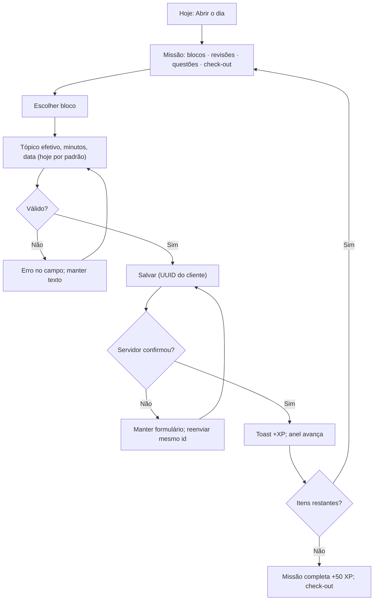

# UX e jornadas

Versão 2.0 · 09/10/2026.

## Direção visual

**Painel de auditor em modo jogo**: tema escuro único, sóbrio, com elementos de HUD. Nada infantil; o jogo comunica ritmo, não diversão gratuita. O app abre direto em **Hoje**, sem hero de marketing. A página original continua disponível como leitura do plano.

### Tokens de cor (tema escuro, contraste AA)

| Token | Valor | Uso |
|---|---|---|
| `bg` | `#0B1220` | Fundo da página |
| `surface` | `#121A2B` | Cartões |
| `surface-2` | `#1A2438` | Cartões elevados, inputs |
| `border` | `#26324A` | Divisórias |
| `text` | `#E6EAF2` | Texto principal |
| `text-muted` | `#9AA6BD` | Texto secundário |
| `primary` | `#3B82F6` | Ações, links, foco |
| `xp` | `#FACC15` | XP, nível, conquistas (amarelo herdado do site) |
| `streak` | `#FB923C` | Chama da sequência |
| `success` | `#22C55E` | Concluído |
| `danger` | `#F87171` | Erros, atrasos |
| P1 / P2 / P3 | `#60A5FA` / `#A78BFA` / `#34D399` | Identificação de prova, sempre com rótulo textual |

Cor nunca é o único sinal: estados também usam ícone e texto.

### Tipografia (auto-hospedada via `@fontsource`)

| Família | Uso |
|---|---|
| **Chakra Petch** 500/600/700 | Títulos, HUD, nível, nomes de conquista e etapa |
| **Inter** 400/500/600 | Texto corrido, formulários, rótulos |
| **JetBrains Mono** 400/600 | Números (XP, minutos, contagens, D-n), códigos de tópico (E01.02) |

Texto principal ≥ 16 px; rótulos ≥ 14 px; números do HUD com `font-variant-numeric: tabular-nums`.

### Movimento

Barra de XP e anel da missão animam ao mudar (≤ 400 ms). Subida de nível e conquista mostram cartão com brilho discreto. Com `prefers-reduced-motion`, sem animação: só troca de estado.

## Estrutura

**HUD fixo** (todas as telas): `Nv 4 · Analista` + barra de XP do nível · 🔥 sequência (+ ❄ congelamentos) · `D-65` até a prova. No celular, o HUD é compacto, em uma linha.

| Tela | Conteúdo e ação principal | Fatia |
|---|---|---|
| Hoje | Abrir o dia, anel da missão, itens com ação direta, XP do dia; Registrar sessão | F1 |
| Ciclo | Semana em lista por dia/janela; remanejar, concluir, dispensar; gerar semana | F1 |
| Edital | P1/P2/P3, disciplinas, tópicos, referência; declarar progresso | F1 |
| Prática | Lotes e caderno de erros | F2 |
| Metas | Metas da semana (planejado × realizado) | F2 |
| Revisões | Vencidas/hoje/futuras; concluir ou dispensar | F3 |
| Discursivas | Tipos, limites, rubrica; registrar treino | F4 |
| Jornada | Etapas, metas da etapa, chefões, marcos do concurso, rebalanceamento | F4 |
| Progresso | Horas, cobertura, amostras, simulados | F5 |
| Conquistas | Grade bloqueadas/desbloqueadas | F5 |
| Configurações | Metas, folgas, versão do edital, exportar/restaurar | F1 (básico) · F5 (portabilidade) |

Desktop: navegação lateral. Celular: barra inferior com Hoje, Ciclo, Prática, Revisões e “Mais”. Ciclo mobile em lista; não esmagar 15 colunas. Suportar ampliação de texto a 200%.

## Fluxo A — Primeira utilização (09/10/2026)

`docker compose up -d` → abrir `http://127.0.0.1:8080` → app já tem catálogo, plano e template inicial (seed) → tela Hoje oferece **“Gerar semana”** (parcial: S13–S15) → **“Abrir o dia”** → missão com 3 blocos e check-out. Opcional: instalar como app no celular via endereço Tailscale. Sem formulário de cadastro.

## Fluxo B — Dia típico

O formulário de sessão vem com o bloco, a data e o tópico sugerido preenchidos e “concluir bloco” marcado: o caminho feliz são 2 toques + minutos. Bloco indisponível → “Não se aplica hoje” ou “Remanejar”.

Sábado/domingo: “Abrir o dia” mostra a **missão livre**: escolher até 2 blocos pendentes da semana (remanejados para hoje), revisões pendentes e, opcionalmente, a meta de questões e o check-out. Estudo fora disso entra como sessão avulsa. Se não abrir, nada é cobrado.

## Fluxo C — Praticar questões (F2)

Resolver em plataforma externa → Prática → prova/tópico → fonte e contagens → validar total → salvar → nota líquida, taxa de acerto, amostra e `+XP` → registrar erro quando necessário.

Mensagem exemplo: “10 itens · 6 acertos · 4 erros · nota líquida 4/20 em P3. Lote parcial; não comparável ao mínimo oficial. +10 XP.”

## Fluxo D — Revisar (F3)

Missão ou fila → tarefa → nota/erro de origem → estudar fora → sessão de revisão opcional → concluir. Concluir não cria minutos. Atrasada continua visível sem duplicação.

## Fluxo E — Discursiva (F4)

Tipo → referência/enunciado → treinar → duração e linhas → rubrica → salvar → nota pessoal opcional. “30 linhas” é limite do edital; “nota pessoal” é avaliação, nunca oficial.

## Fluxo F — Chefão de etapa (F4)

Jornada → etapa atual → metas e chefão → criar simulado → associar lotes P1/P2/P3 até 40/40/90 → chefão derrotado (+100 XP), mínimos comparados → associar discursivas → NFC estimada só com duas notas manuais. Após o chefão da etapa 1, mostrar sugestão de rebalanceamento com aceitar/ajustar/recusar.

## Fluxo G — Remanejar, folga e restaurar

Remanejar: editar data/janela de ocorrência pendente → preview → salvar a mesma ocorrência. Folga: Configurações ou Hoje → “Marcar folga” (feriado/doença/compromisso) → sequência recalculada. Restaurar (F5): selecionar JSON → dry-run com novos/iguais/conflitantes → confirmar → transação única.

## Estados obrigatórios

| Situação | Comportamento |
|---|---|
| Sem registros | Ciclo e “Abrir o dia”; HUD em Nv 1 com 0 XP, sem números fictícios |
| Semana não gerada | Botão “Gerar semana”; consulta não grava |
| Dia não aberto | Botão “Abrir o dia” com prévia dos itens |
| Carregamento | Esqueleto discreto; não exibir zero como resultado |
| Rede indisponível | Manter formulário; explicar que salvar depende do servidor (Mac ligado) |
| Reenvio | Retornar registro original, sem duplicar |
| Edição concorrente | Avisar conflito, recarregar; não sobrescrever |
| Sequência em jogo | “Hoje ainda conta: faltam N min para manter a sequência” |
| Congelamento usado | Marcar o dia no histórico com ❄ |
| Nenhuma resposta válida | Taxa de acerto indisponível, não 0% |
| Exclusão de sessão | Confirmar efeito em métricas, revisões e XP |
| Fonte com retificação | Exibir versão do edital usada |

## Microtextos fixados

- “Abrir o dia”, “Registrar sessão”, “Remanejar bloco”, “Não se aplica hoje”, “Concluir revisão”.
- “XP mede constância, não preparo.”
- “Cobertura declarada não mede domínio do conteúdo.”
- “Resultado parcial: não é comparação com os mínimos da prova completa.”
- “Nota discursiva informada pelo usuário ou revisor; não é nota oficial.”
- “Os dados só serão salvos após confirmação do servidor.”
